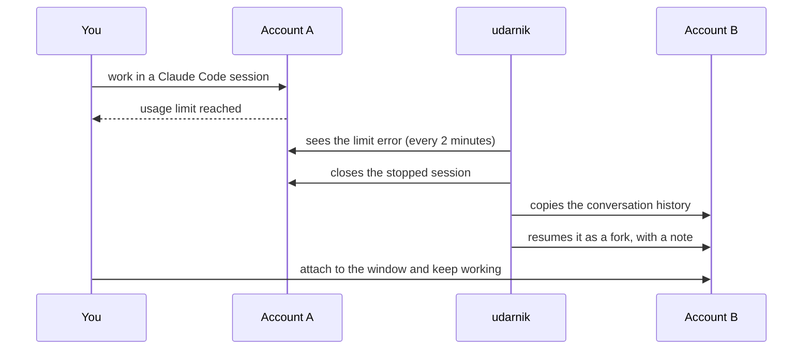
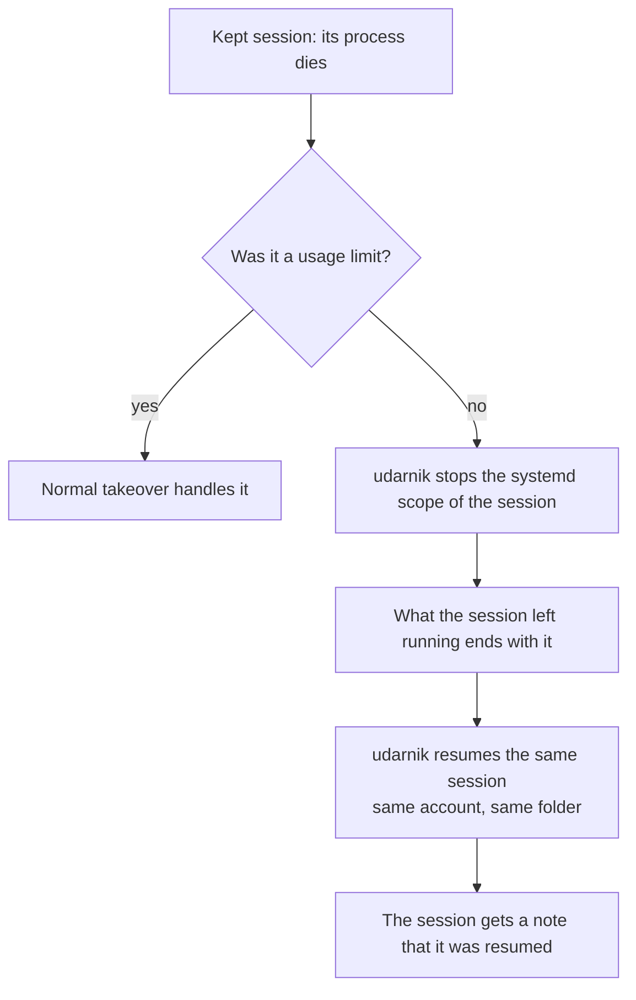
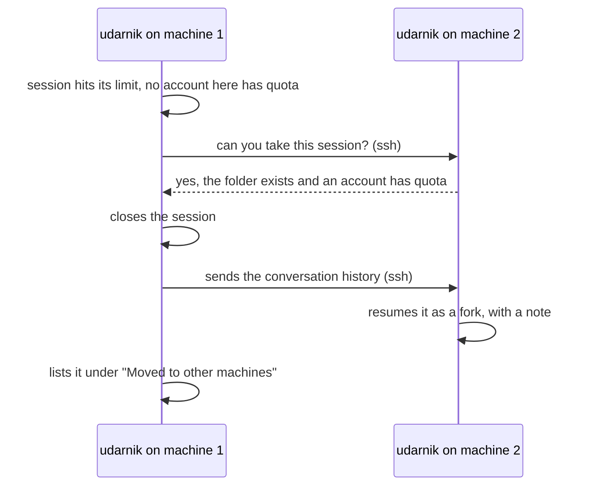

# udarnik

**When a Claude account runs out of quota, your session carries on with another one.**

udarnik is a helper for people who use [Claude Code](https://claude.com/claude-code) with more than one Claude
account, and sometimes on more than one machine. It watches your sessions. When the account of a session hits its
usage limit, udarnik closes that session and continues the same conversation on an account that still has quota.

The name: an *udarnik* was a Soviet "shock worker", the one who never stopped working. Here the next account takes
the shift.

## At a glance

| | |
|---|---|
| **What it does** | Moves a Claude Code conversation to another account (or another machine) when its account is out of quota. |
| **When you need it** | You have two or more Claude accounts, and long sessions that must not stop in the middle of the work. |
| **How you use it** | Type `/takeover` inside Claude Code, or run `udarnik start` in a terminal. |
| **What else it does** | Gives scripts a safe way to pick an account and wait for quota. Brings back a session whose process died. Shows one board for all accounts, sessions and machines. Stops everything with one command. |
| **Technical details** | [docs/REFERENCE.md](docs/REFERENCE.md) |

## The problem

You start a long task in Claude Code. An hour later the account reaches its usage limit and the session stops in the
middle of the work. You have another account with quota, but moving the conversation there by hand is slow: find the
history, copy it, resume it, explain what happened.

udarnik does those steps for you, and it keeps doing them for as long as there is an account with quota.

## How it works

You turn udarnik on once. A small background service then looks at your sessions every two minutes. For each
session, it reads the end of the conversation. If the last thing Claude said is the "usage limit reached" error, the
service takes over:

1. It notes that the account is out of quota until the time in the error.
2. It picks the next account that has quota.
3. It closes the stopped session, so its history is complete.
4. It copies the history to the new account.
5. It resumes the conversation there, as a fork, in a window of a private tmux (a terminal multiplexer: it keeps
   terminal windows alive in the background). The new session gets a message that says why it exists and to check
   the real state before it relaunches anything.
6. It watches the new session too. If this account runs out as well, the chain goes on.



The resumed session lives in a tmux window. You do not have to watch it: it works on its own. When you want to see
it, `udarnik view` opens a terminal on it.

> [!NOTE]
> The resumed session is a **fork**: a new session that starts with the whole conversation of the old one. The old
> session stays in the history of its account, untouched.

## What you need

- Linux with a systemd user manager (`systemctl --user` works), `tmux`, `jq`, `python3`, `flock` (util-linux),
  `setsid`, `systemd-run`, `tar`, bash 4 or newer.
- Claude Code with two or more accounts on the same machine: `~/.claude` and `~/.claude-*`, each with its own
  login. Log in to each one with `CLAUDE_CONFIG_DIR=~/.claude-work claude`, and open it once, interactively.
- For several machines: `ssh` with keys between them (no password prompts).

## Install

```
./install.sh              # install or update
./install.sh --uninstall  # remove what install.sh installed
```

The installer copies udarnik to `~/.local/share/udarnik`, puts the `udarnik` command in `~/.local/bin` and installs
the `/takeover` skill for every account. It never restarts a running service. The options and the details are in the
[reference](docs/REFERENCE.md#install-update-uninstall).

## Everyday use

Each thing below has two ways: type the `/takeover` command inside Claude Code, or run the `udarnik` command in a
terminal. Both do the same.

| I want to... | In Claude Code | In a terminal |
|---|---|---|
| Turn it on | `/takeover` | `udarnik start` |
| Turn it on only for some sessions | `/takeover` and say which ones | `udarnik start --only ID,ID` or `--root DIR` |
| Look at the board | `/takeover status` | `udarnik status` |
| See or attach to a resumed session | `/takeover view` | `udarnik view` |
| Turn it off (clones keep running) | `/takeover off` | `udarnik stop` |
| Stop everything at once | tell it "stop everything" | `udarnik stop --all` |
| Keep a session alive | `/takeover keep ID` | `udarnik keep ID` |
| Pin a session to this machine | `/takeover pin ID` | `udarnik pin ID` |
| Move a session to another machine | `/takeover move ID MACHINE` | `udarnik move ID --to MACHINE` |
| Control another machine | add the machine name | add `--on MACHINE` (one) or `--fleet` (all) |
| Let scripts change accounts | `/takeover runners on` | `udarnik runners on` |

`ID` is the start of a session id, as the board shows it.

### The board

`udarnik status` shows, in one place:

- each account: available, or out of quota until a given time, with its weekly usage;
- the sessions udarnik watches, and which are pinned or kept;
- the resumed sessions ("clones") and the tmux window of each one, with the command that attaches to it;
- scripts that run Claude in the background and scripts waiting for quota.

### Turn it off

`udarnik stop` stops new takeovers. The resumed sessions keep running, and the service leaves by itself when none
is left. `udarnik stop --all` ends the service, every resumed session, the background Claude processes and the
waiting scripts, and says what it ended.

> [!WARNING]
> `udarnik stop --all` closes the resumed sessions. Use plain `udarnik stop` when you only want to stop new
> takeovers.

### Keep a session alive

Some sessions host other work, for example a session whose background agents run a whole campaign. If its process
dies, that work is lost and the leftovers may keep running on their own. Mark the session with `udarnik keep ID`.
While udarnik is on, it then does this:



> [!TIP]
> To make the cleanup work, start the session in a scope of its own:
> `systemd-run --user --scope --unit=NAME claude`. Without it, the session still comes back, but what it left
> running is not ended. Before you close a kept session on purpose, run `udarnik unkeep ID`: closing it counts as a
> death, and udarnik would bring it back.

### Several machines

With a fleet file (one file that lists your machines; see the [reference](docs/REFERENCE.md#several-machines)),
udarnik works across machines:

- one board shows all of them (`udarnik status --fleet`);
- an account that is out of quota on one machine is marked out on all of them;
- when no account on a machine has quota, the session moves to another machine that has one;
- you can move a session by hand with `udarnik move ID --to MACHINE`;
- a session that needs its machine (for example, it works on a checkout only that machine has) stays there if you
  pin it with `udarnik pin ID`.



> [!NOTE]
> Only the conversation moves. Changes that were not committed and pushed stay on the old machine. The new session
> is told to check.

### Scripts and background Claude processes

Scripts that call `claude -p` (called "runners" here) can ask udarnik which account to use, and can wait for quota
in a way you can see on the board and stop. This is off until you run `udarnik runners on` (or `udarnik start`).
The commands, the exit codes and a full example are in the
[reference](docs/REFERENCE.md#account-hook-for-runners).

## Questions

**Will I lose my conversation?**
No. The whole history is copied to the new account and the conversation resumes from it. What does not come along is
what lived outside the history: subagents, builders, background tasks and messages between sessions. The new session
is told this and checks the real state before it relaunches anything.

**What happens if every account is out of quota?**
Nothing is closed. udarnik tries again at the next round (every two minutes by default) and acts when an account is
back. With several machines, it first tries to move the session to a machine that has an account with quota. A
runner script that finds every account out calls `udarnik account wait`, which waits until one is back.

**How does udarnik know when an account is back?**
From the reset time in the limit error. When the error has none, it assumes one hour. A script can also tell udarnik
that a call worked in that account (`udarnik account clear`), which proves the account is back.

**Does it touch sessions that an app like T3 Code hosts?**
No. udarnik shows them on the board, but it never closes, clones or keeps a session an app hosts: the app owns that
session's process and conversation, and a copy in tmux would run the same session twice. When such a session hits its
limit, udarnik writes one line in its log and leaves it to the app (T3 Code can resume it after the reset, or you
open it again on another account there). `udarnik stop --all` does not end them either.

**Does it touch my background `claude -p` processes?**
It never takes them over: they are "workers", only listed on the board. `udarnik stop --all` ends them.

**How do I stop everything at once?**
`udarnik stop --all`, or `udarnik stop --all --fleet` for every machine. It prints how many processes it ended, and
exits with an error if something is still alive.

**Is anything sent anywhere?**
No. udarnik never calls an API. The only network use is ssh to the machines of your fleet file; without that file it
uses no network at all. The weekly usage is read from a local file that something else keeps (typically a status
line script).

**Will it answer questions that Claude asks in the resumed session?**
Only two kinds: it says "Yes, I trust this folder", and it answers Yes to a permission question that exists only
because of the move. Any other question is not answered. It becomes a line with the word `ATTENTION` in the log,
with the window to open.

## Limits and caveats

> [!WARNING]
> udarnik relies on Claude Code internals: the session files, the history file, the way the limit error is written
> and the text of the permission dialog. It was checked with Claude Code 2.1.311. A new Claude Code release can
> break the detection. The tests use fakes and do not prove the real client.

- A resumed session is a fork. Subagents, builders, background tasks and messages between sessions of the old session
  are gone.
- A resumed session only starts on an account that you opened interactively at least once on that machine.
- Several machines need ssh keys and synchronized clocks (NTP).
- udarnik runs on Linux with systemd.

## More

[docs/REFERENCE.md](docs/REFERENCE.md) holds the technical page: every command and option, every environment
variable, the state directory, the account hook for runners, how long an account stays out, kept sessions, the fleet
and the tests.
